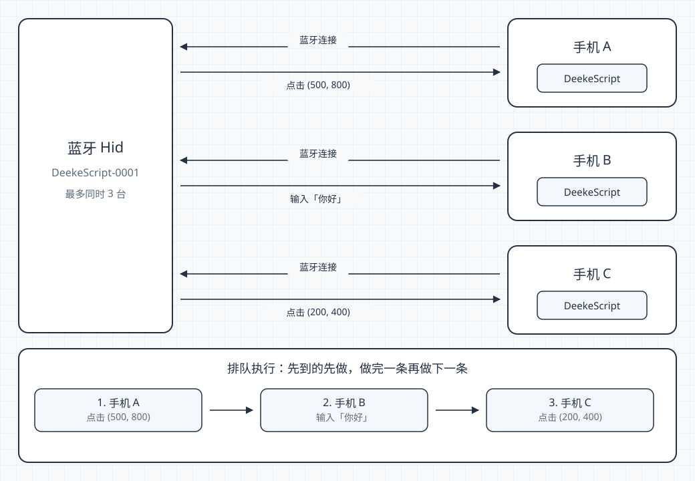

# ESP32-C3 蓝牙 Hid 烧录

DeekeScript Pro 的蓝牙 Hid 固件。只支持 **ESP32-C3**，ESP32、S2、S3 不能用这份脚本。

完整说明见 [Hid 烧录](https://script.deeke.cn/hid/bluetooth.html)。

## 烧录后的硬件能力

烧进板子的固件，会把这块 ESP32-C3 变成蓝牙 Hid。**一块板最多同时连接 3 台手机**。三台都配对同一个名称，例如 `DeekeScript-0001`。每台手机自己跑脚本、自己连板子发动作。

<p align="center">
  
</p>

三台发出的点击、滑动和输入进同一条队列，按到达顺序做，不是并发。做到哪一台，动作就只发生在哪一台的屏幕上。上图里三台几乎同时开始时，板子会按到达顺序处理，例如：

1. 手机 A 执行 `Hid.tap(500, 800)`，点击只落在手机 A
2. 手机 B 执行 `Hid.type("你好")`，文字只进手机 B
3. 手机 C 执行 `Hid.tap(200, 400)`，点击只落在手机 C

第 4 台连不上这一块。再烧一块并改成 `DeekeScript-0002`，那一块同样最多 3 台。以前烧过、同时只能连一台的板子，按下面命令重新烧录后再配对即可。

## 准备

- <a href="https://arduino.github.io/arduino-cli/installation/" target="_blank" rel="noreferrer">arduino-cli</a>，并装好 ESP32 核心和 NimBLE-Arduino
- <a href="https://github.com/espressif/esptool/releases" target="_blank" rel="noreferrer">esptool</a>
- <a href="https://www.python.org/downloads/" target="_blank" rel="noreferrer">Python 3</a>

macOS：

```bash
brew install arduino-cli esptool
arduino-cli config add board_manager.additional_urls https://espressif.github.io/arduino-esp32/package_esp32_index.json
arduino-cli core update-index
arduino-cli core install esp32:esp32
arduino-cli lib install "NimBLE-Arduino"
```

Windows 用 Git Bash，并且上面三个命令能直接运行。

用 USB 接上板子，直接运行烧录命令。这块 ESP32-C3 不用按 BOOT 或 RST，脚本会自己通过串口进入下载。新板、以及已经烧过其他程序的板子，再次烧录都不用按任何按键。烧录时不要按这两个键，烧完也不用再按 RST。

只有命令一直停在等待下载、串口也连不上时，才按住 BOOT、点一下 RST、再松开 BOOT，然后重新烧录。

## 烧录

```bash
git clone https://github.com/DeekeScript/ESP32-C3.git
cd ESP32-C3
```

名称是 `DeekeScript-` 加 4 位。只写数字会补零，`1` 会变成 `0001`。

```bash
./flash.sh DeekeScript-0001
./flash.sh 0001
./flash.sh
```

不写名称时，用 `DeekeScript-` 加芯片 MAC 后 4 位，例如 `DeekeScript-5E68`。

串口自动识别：macOS 找 `/dev/cu.usbmodem*`，Linux 找 `/dev/ttyACM*` 或 `/dev/ttyUSB*`，Windows 找乐鑫原生 USB 串口（`VID_303A`）。多块板同时插着，或 Windows 上是 CH340 这类串口芯片时，再指定端口：

```bash
PORT=/dev/cu.usbmodem101 ./flash.sh DeekeScript-0001
PORT=COM3 ./flash.sh DeekeScript-0001
```

烧录结束会打印 `烧录完成: DeekeScript-0001`。Flash 按 DIO 接线，不要改成 QIO。

手机蓝牙里搜索这个名称并配对。换过板子或改了名称时，取消旧名称的配对，只保留当前这块板。升级固件后如果按键异常，可在手机上取消配对再重新配对，让系统重新读取按键表。
